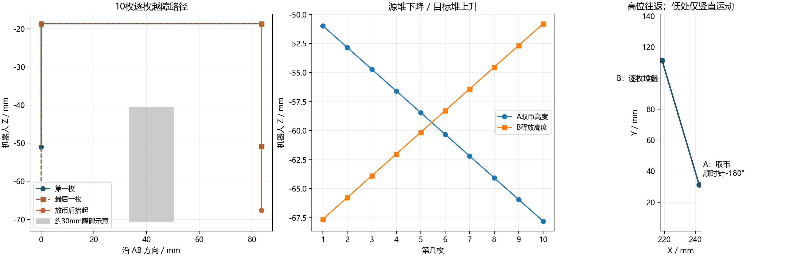
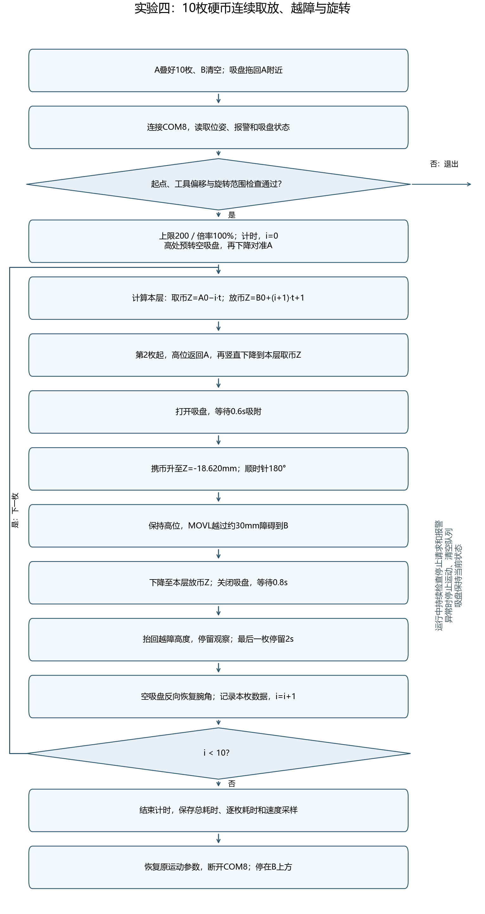

# 10枚硬币连续码垛

在“实验一”目录运行：

```powershell
python "4.码垛/code/coin_demo.py" plan
python -m unittest discover -s "4.码垛/code" -p test_coin_demo.py -v
```

默认离线生成计划。实机执行：

```powershell
python "4.码垛/code/coin_demo.py" run --execute
```

每次启动前，在原位置 A 将 10 枚硬币叠好、文字朝向一致，并清空 B。手动将吸盘拖回 A 附近，保持本次采点时的腕部方向。允许 XY 距离15mm、Z偏差±10mm、R偏差±15°；程序先抬升，在高处将空吸盘预转到可完整旋转180°的姿态，再下降到整叠最上层吸币。程序完成后恢复采点时的腕角，停在 B 上方。再次演示前需将完整10枚叠回A，程序从第1枚重新开始。

当前端口为 **COM8**。运行期间需由本程序独占串口。共享 SDK 位于 `../../3.平面绘图操作/code/`，请保持目录结构。

## 本次标定与厚度

| 项目 | 数值 |
|---|---:|
| A：复位后10枚堆顶接触位 | X=242.513，Y=31.320，Z=−50.975mm，R=30.295° |
| B：复位后目标桌面接触位 | X=218.661，Y=111.413，Z=−70.490mm |
| AB平面距离 | 83.570mm |
| 10枚总厚度估计 | 18.700798mm |
| 单枚厚度 t | 1.8700798mm |
| 障碍物高度 | 约30mm |
| 携币时障碍上方余量 | 20mm |
| 统一越障Z（吸盘接触面） | −18.620mm |

厚度沿用复位前用户确认的估计值：总厚18.700798mm、单枚1.8700798mm。该值原按同一水平桌面的A堆顶与B桌面高度差计算；复位后重采了位置，厚度没有重新估计。本次新A/B的Z差为19.514839mm，与已确认总厚相差约0.814mm；取币与放币分别按各自新基准计算。每枚高度均由初始基准直接计算，避免循环累加误差。可在配置中修改 `coin_thickness_mm`，或覆盖运行参数：

```powershell
python "4.码垛/code/coin_demo.py" plan --coin-thickness 1.85
```

若确认使用覆盖值，实机命令也要带相同的 `--coin-thickness` 参数。

## 逐层控制与循环

令 i 从0计数到9，A₀为整叠最上层接触Z，B₀为目标桌面接触Z：

```text
第i+1枚取币Z = A₀ − i × t
B已有i枚的堆顶Z = B₀ + i × t
第i+1枚释放Z = B₀ + (i+1) × t + 1mm
```

释放Z包含吸盘下方持有的一枚硬币厚度，硬币底面在已有堆顶上方约1mm处释放，以减少落币偏移。逐枚高度表见 `../results/height_schedule.md`。

每枚执行：吸盘开启并等0.6s → 竖直抬升 → 高处旋转180° → 高位移到B → 下降到本层释放Z → 关闭吸盘并等0.8s → 抬回越障高度 → 停留观察 → 空吸盘恢复原腕角。

前9枚完成后，在高处返回A并竖直下降到下一层；第10枚完成后停在B上方。中间每枚抬起后停留0.5s，最后一枚停留2s。放币后抬升至少20mm，并保证下一次水平返回的高度足以越过障碍。越障高度同时覆盖障碍、初始源堆、最终目标堆，并额外计入吸盘下方的币厚。



## 旋转与速度

复位后A的J4约为22.936°，直接正转或反转180°都会超出腕部范围。程序在吸币前先于高处将空吸盘预转到J4=90°，取币时R约为97.359°；吸住后 **顺时针−180°**，目标R约为−82.641°，沿携币路径J4约为−109.641°～90°。

空吸盘预转发生在吸住硬币之前；硬币仍由实际吸取姿态完整转过180°。每枚都使用相同取币姿态，旋转角不会累积。中间各枚释放后恢复到下一次取币的腕角，第10枚完成后恢复最初采点的J4=22.936°，便于手动拖回A再次运行。若强制选择逆时针，程序会改用相应的高处空吸盘预转姿态。

运动参数继续采用官方PTP示例基准：XYZ速度200mm/s、加速度200mm/s²；R和各关节速度200°/s、加速度200°/s²；速度、加速度倍率均为100%。执行前设置并读回核对，结束或异常退出时恢复运行前参数。短程未必达到设定上限，程序同时记录SDK采样速度。

## 停止、日志和验证

另开终端请求停止：

```powershell
python "4.码垛/code/coin_demo.py" stop
```

脚本持续检查停止请求和报警。中断时停止运动、清空队列，保留当前吸盘状态。记录会标明已完成的枚数和正在执行的阶段；中断后重新执行前，应先恢复A整叠10枚、B清空的初始状态。

`code/records/runs/日期时间/record.json` 保存本次完整日志，`results/latest_run.json` 保存最近一次实机日志。每枚流程完成时也写入一次运行记录，包含枚序、取放阶段、逐枚吸取至释放耗时、循环耗时、采样峰值、总耗时、参数回读、报警和中断原因。全程计时从起点自动校正或首次吸币开始，含观察停留、空吸盘复位及9次返回；另记录首次吸取到最后释放、最后释放后抬起的时间。

当前10枚版本已通过27项离线测试，含复位后重新配对A/B、空吸盘预转和连续半圈旋转，尚未实机连续搬运；已有单枚录像、照片、表格和历史日志仍属于此前演示。新的10枚耗时将在执行后记录。吸盘开关回读无法检测是否真正持币或释放，分离和文字方向需观察或录像确认。



重新生成流程图：

```powershell
python "4.码垛/code/make_flowchart.py"
```
